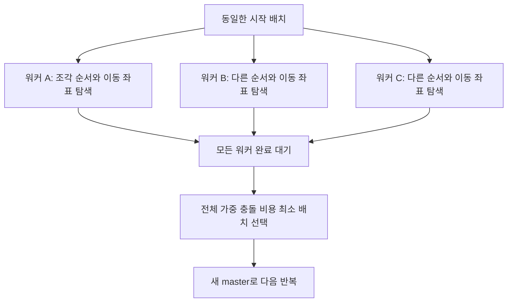

# Explore·Separator 병렬 탐색 개선 검토

> **폐기됨 — 2026-09-09 사용자 요청.** 이 문서는 채택하거나 구현할 계획으로 사용하지 않는다. 특히 성공한 워커가 다른 워커를 중단시키는 제안은 폐기했다. 후속 검토는 [완료한 워커가 독립적으로 다음 후보를 처리하는 구조](C:/Caplanet/AiWorks/AdaptiveAlgorithm2/docs/SWARM_SEPARATOR_ASYNC_CONTINUATION_REVIEW_2026-09-09.md)다. 아래는 당시 검토 기록이다.

2026-09-09 / 대상: `C:\Caplanet\AiWorks\AdaptiveAlgorithm2`의 현재 작업 트리

**요청한 방식은 가능하다. 현재도 워커들은 서로 다른 탐색을 하지만, 동일한 시작 배치를 매번 복원하고 모든 워커의 완료를 기다린다. 우선 개선할 대상은 이 반복 준비와 완료 대기다.**

이번에는 소스 흐름을 검토하고 개선안을 작성했다. 아래 제안은 아직 실행 코드에 적용하지 않았다. 실행 중인 앱의 설정·DLL·성능 프로파일은 확인하지 않았으므로 실제 후보 중복률이나 속도 개선율을 확정하지 않는다. Uttu.Nest와 fable 소스는 읽지 않았다. Config 조정이나 컴파일 기능 추가를 해결책으로 제안하지 않는다.

## 1. 지금 워커들이 실제로 하는 일

### 1.1 동일한 시작 배치에서 서로 다른 이동 순서와 좌표를 탐색한다

`Separator::move_items_multi()`는 다음 순서로 작동한다.

1. master 배치를 저장한다.
2. 각 워커가 같은 배치와 충돌 tracker를 불러온다.
3. 각 워커가 충돌 중인 이동 가능 조각 또는 그룹 대표를 모은다.
4. 워커별 RNG로 조각 순서를 섞는다.
5. 해당 워커의 현재 배치에서 이동 좌표를 샘플링하고, 선택한 이동을 즉시 그 워커의 배치에 반영한다.
6. 모든 워커가 한 번의 조각 순회를 끝낼 때까지 기다린다.
7. **전체 GLS 가중 충돌 비용이 가장 낮은 워커**의 problem과 tracker를 master로 가져온다.
8. 다음 반복에서 다시 모든 워커를 이 master 상태로 맞춘다.

따라서 **하나의 좌표를 워커 수만큼 똑같이 검사하도록 분배하는 구조는 아니다.** 동일한 문제를 서로 다른 이동 경로로 푸는 구조다. 한 워커 내부에서 조각을 옮기면 이후 조각은 이미 바뀐 배치를 보므로, 다른 워커와 평가 대상 환경도 달라진다.

근거:

- [워커별 RNG 생성](C:/Caplanet/AiWorks/AdaptiveAlgorithm2/swarm-core/src/optimizer/separator.rs:195)
- [병렬 라운드와 결과 선택](C:/Caplanet/AiWorks/AdaptiveAlgorithm2/swarm-core/src/optimizer/separator.rs:536)
- [그룹 순회](C:/Caplanet/AiWorks/AdaptiveAlgorithm2/swarm-core/src/optimizer/worker.rs:106), [개별 조각 순회](C:/Caplanet/AiWorks/AdaptiveAlgorithm2/swarm-core/src/optimizer/worker.rs:198)

### 1.2 그래도 중복이 생기는 지점은 있다

| 지점 | 확인한 동작 | 의미 |
|---|---|---|
| 라운드 시작 상태 | 모든 워커가 같은 배치를 복원 | 상태 준비가 반복됨 |
| 충돌 조각 목록 | 같은 시작 상태에서 각자 수집 후 shuffle | 최초 목록 계산을 공유할 여지 |
| 현재 위치 평가 | 각 조각 탐색은 현재 위치도 후보로 평가 | 같은 조각을 같은 상태에서 먼저 처리하면 중복 가능 |
| 난수 샘플 | 워커별 RNG 사용 | 서로 다르지만 후보 영역을 명시적으로 분할하지는 않음 |
| NFP 샘플 | RNG를 사용하지 않는 결정적 후보 생성 | 동일 배치·조각·조건에서는 같은 후보 목록을 만들 수 있음 |
| 좌표 하강 | 서로 다른 시작점도 같은 위치로 수렴 가능 | 결과 중복 가능, 실제 빈도는 미측정 |

NFP 샘플러는 코드가 명시적으로 `let _ = rng`를 사용한다. 난수 시드를 바꾸는 것만으로 이 후보 생성의 중복을 없앨 수 없다. 다만 NFP를 써도 워커의 조각 처리 순서는 다를 수 있으므로 전체 결과가 항상 동일하다고 볼 수는 없다.

근거: [NFP 후보 생성·평가](C:/Caplanet/AiWorks/AdaptiveAlgorithm2/swarm-core/src/sample/nfp_sampler.rs:124), [현재 위치·난수 샘플·좌표 하강](C:/Caplanet/AiWorks/AdaptiveAlgorithm2/swarm-core/src/sample/search.rs:308).

## 2. 이미 적용된 최적화와 남아 있는 비용

현재 단일 조각 평가에는 공간 검색, pole 기반 빠른 검사, 가중 비용 상한을 넘으면 조기 기각하는 기능이 있다. SIMD 경로에는 pole 비용 계산과 상한 기반 중단도 있다. 따라서 모든 후보가 항상 모든 조각의 모든 변을 끝까지 비교하는 것은 아니다.

또한 평가 버퍼 재사용, tracker 행렬의 불변 공유, 승자 problem/tracker의 소유권 교환, 성공 인증 캐시가 이미 있다. 이를 새로 해야 할 작업으로 중복 제안하지 않는다. 직전 적용한 R&R 비활성·비주기 통계 생략도 현재 소스에 있다.

남아 있는 비용은 다음과 같다.

- `par_iter_mut().map(...).collect()`가 모든 워커 완료를 기다린다. 워커 사이의 성공 통보·동료 중단 플래그가 없다.
- 매 라운드 `prob.save()`와 각 워커의 `restore()`가 있다. 워커마다 충돌 대상 목록도 수집한다.
- tracker 공유는 첫 쓰기까지다. 이동으로 행렬에 쓰면 `Arc::make_mut`가 해당 워커용 전체 행렬을 복사할 수 있다. **이미 공유 최적화가 있으므로 load마다 무조건 전체 행렬을 복사한다고 계산하면 틀린다.**
- `update_weights()`는 전체 쌍 행렬을 순회한다. 충돌 없는 쌍도 과거 GLS 가중치를 감쇠하므로 단순히 현재 충돌 쌍만 남기면 알고리즘 의미가 달라진다.
- 단일 워커일 때도 현재 다중 워커용 저장·복원·선택 경로를 사용한다.
- Separator 진입 시 이미 loss가 0이어도 워커 라운드를 먼저 실행한다. 원본 검사·보정과 인증은 유지하면서 이 빈 라운드를 생략할 여지가 있다.

근거: [평가 상한](C:/Caplanet/AiWorks/AdaptiveAlgorithm2/swarm-core/src/eval/sep_evaluator.rs:143), [충돌 파이프라인](C:/Caplanet/AiWorks/AdaptiveAlgorithm2/swarm-core/src/eval/specialized_jaguars_pipeline.rs:32), [tracker 공유](C:/Caplanet/AiWorks/AdaptiveAlgorithm2/swarm-core/src/quantify/tracker.rs:194), [쓰기 시 복사](C:/Caplanet/AiWorks/AdaptiveAlgorithm2/swarm-core/src/quantify/pair_matrix.rs:17), [GLS 갱신](C:/Caplanet/AiWorks/AdaptiveAlgorithm2/swarm-core/src/quantify/tracker.rs:270).

## 3. “성공하면 다른 워커를 멈춘다”의 정확한 의미

| 성공의 종류 | 중단해도 되는 범위 | 판단 |
|---|---|---|
| 한 이동 후보가 이전보다 좋아짐 | 자동으로 다른 작업을 중단할 근거 없음 | 더 좋은 후보를 버리고 작은 개선만 반복할 수 있음 |
| 한 조각의 후보가 `Clear { loss: 0 }` | 그 조각의 같은 목적을 가진 대안 후보 평가 | 적용 가능. 다른 충돌 조각의 작업까지 중단하면 안 됨 |
| 한 워커의 **전체 배치 tracker loss가 0** | 같은 시작 문제를 푸는 동료 워커 | 분리 성공 제안. 원본 보정·정밀 인증이 아직 남음 |
| 전체 배치가 원본·제약 인증까지 통과 | 같은 폭을 푸는 대안 작업 | 승자 채택 후 다음 폭/다음 작업으로 전환 가능 |
| 다른 사이즈 lane 하나가 성공 | 다른 lane 작업 | 각 lane은 별도 필수 작업이므로 일괄 취소하면 안 됨 |

현재 Separator는 가중 비용으로 워커를 고르지만, `min_l`과 최소 배치 보존은 비가중 총비용을 사용한다. GLS가 국소 정체를 벗어나도록 서로 다른 목적을 맡는 것이다. 이를 “먼저 조금 개선한 워커”로 바꾸면 동등한 최적화가 아니라 탐색 정책 변경이다.

특히 현재 Basic/Adaptive Explore는 tracker 0 후보가 정밀 인증에서 실패하면 최선 인증 결과를 유지하고 루프를 종료한다. **조기 승자 정책을 넣으면서 이 실패 경로를 그대로 두면, 먼저 나온 미인증 후보 때문에 다른 유망한 후보까지 버릴 수 있다.** 후보 기각 후 다른 작업을 재개하는 경로가 함께 필요하다.

근거: [Separator 성공·최소값 보존](C:/Caplanet/AiWorks/AdaptiveAlgorithm2/swarm-core/src/optimizer/separator.rs:438), [원본 보정](C:/Caplanet/AiWorks/AdaptiveAlgorithm2/swarm-core/src/optimizer/separator.rs:527), [인증 계약](C:/Caplanet/AiWorks/AdaptiveAlgorithm2/swarm-core/src/optimizer/separator.rs:267), [Explore 인증 실패](C:/Caplanet/AiWorks/AdaptiveAlgorithm2/swarm-core/src/optimizer/explore_mods.rs:735).

## 4. 권장하는 단계별 구조

### 4.1 먼저: 현재 배치 단위 병렬 구조에 동료 중단을 추가

가장 작은 범위의 실험이다. 워커별 다른 이동 순서와 현재 채택 목적은 유지한다.

1. 라운드마다 내부 종료 상태와 세대 번호를 만든다.
2. 워커는 자신의 배치와 tracker가 함께 갱신된 안전한 지점에서 전체 loss 0을 확인한다.
3. 성공 제안을 게시하고 해당 워커 상태를 더 이상 바꾸지 않는다.
4. 동료 워커는 조각/샘플/좌표 하강 경계에서 중단한다.
5. 작업들을 합류시킨 후 조정자가 성공 배치의 원본 보정·정밀 인증을 수행한다.
6. 통과하면 채택한다. 실패하면 보존한 상태에서 다른 대안을 다시 탐색한다. 실패를 전체 Explore 종료나 성공으로 처리하지 않는다.
7. 승자가 없으면 기존 전체 가중 비용 최소 선택을 유지한다.

이 방식은 현재의 전체 배치 탐색을 유지하면서 마지막 느린 워커를 기다리는 비용을 줄일 수 있다. 완전히 분리되지 않는 어려운 구간에서는 성공 통보 자체가 드물어 이득이 작을 수 있다.

원본 인증이 비싼 경우에는 다음 단계로 **동료가 탐색을 계속하는 동안 조정자가 제안을 인증하고, 인증 성공 후에만 동료를 취소하는 구조**를 고려한다. 채널과 scoped task 등으로 현재의 일괄 collect 구조를 바꿔야 하므로 구현 범위가 더 크다. 첫 실험부터 모든 작업을 완전 비동기로 만들 필요는 없다.

주의할 비용: 매 조각 이동 후 `get_total_loss()`를 호출하면 캐시 무효화 뒤 전체 쌍 합산이 추가될 수 있다. 먼저 한 순회 완료 시 검사해 효과를 측정하고, 조각 단위 즉시 통보가 필요하면 충돌 엔트리 수의 증분 관리 등을 별도로 검증한다. 부동소수 누적 오차로 0을 잘못 판정하는 단순 차감 합계는 피한다.

### 4.2 다음: 한 조각의 좌표 후보를 서로 나누어 평가

사용자가 말한 “각각 다른 후보를 평가하고 성공하면 다른 후보로 전환”을 가장 직접적으로 구현하는 방식이다.

- 조각 하나와 **변하지 않는 배치 스냅샷**을 정한다.
- 후보에 고유 번호를 붙여 작은 묶음으로 워커에 나눠 준다. NFP 결정적 후보는 한 번 생성하고 분배할 수 있다.
- 워커는 읽기 전용 배치와 자신의 평가 버퍼를 사용한다. 좌표 후보 검사마다 전체 problem/tracker를 복원하지 않는다.
- 그 조각에서 더 이상 개선할 수 없는 값인 Clear 0이 나오면 해당 조각의 대안 작업을 협력적으로 중단한다.
- 조정자가 선택한 이동 하나를 반영하고 배치 세대를 증가시킨다. 남은 이전 세대 결과는 폐기한다.
- 새 배치를 기준으로 다음 조각 또는 그룹의 후보를 평가한다.

단점도 있다. 현재는 워커별로 서로 다른 조각 순서를 탐색하지만 이 방식은 하나의 조각 순서에 집중하기 쉽다. 또한 후보 몇 개의 값싼 검사보다 분배·동기화 비용이 클 수 있다. 따라서 **잔여 충돌 조각이 적고 한 조각의 평가가 비싼 구간**이 실험 우선 대상이다. 조각 수가 많을 때까지 일괄 대체할 이유는 아직 없다.

원본 검사는 현재처럼 유망한 전체 배치의 채택 경계에서 유지한다. 모든 샘플에 원본 정밀 인증을 추가하면 이번 속도 개선 목적과 충돌한다.

### 4.3 그다음: Explore가 서로 다른 전체 배치 후보를 동시에 분리

현재는 실패 해 풀에서 하나를 골라 Swap/R&R로 교란한 뒤, 그 한 배치를 Separator 워커들이 함께 푼다. 실패 해 풀의 서로 다른 배치나 서로 다른 교란 결과를 작업 큐에 넣으면 더 큰 탐색 다양성을 확보할 수 있다.

다만 단순히 워커마다 중첩 Separator를 만들면 스레드풀·복제·메모리 비용이 증가한다. 내부 실행기가 전체 CPU 작업 예산을 공유해야 한다. 사용자 Config의 워커 수를 낮춰 해결할 문제는 아니다.

독립 후보들이 서로 다른 GLS 가중치 이력을 갖게 되면 가중 비용을 서로 직접 비교해서는 안 된다. 동일한 폭·제약에서 인증 성공 여부와 비가중 비용을 비교하거나, 비교용 가중치 세대를 통일해야 한다. 더 짧은 인증 배치가 이미 채택됐다면 늦게 도착한 긴 배치는 공개 결과를 덮어쓰지 못하게 한다.

이 단계는 탐색 알고리즘 변경 범위가 크므로 4.1과 4.2의 계측 결과 뒤에 판단하는 것이 적절하다.

## 5. 함께 검토할 구체적인 개선 항목

| 우선순위 | 개선 | 기대 효과와 조건 |
|---|---|---|
| 1 | 이미 loss 0인 Separator의 빈 워커 라운드 생략 | 초기/완화 후 불필요한 복원·순회 감소. 원본 보정과 인증은 수행 |
| 1 | 동일 transform의 remove/place 생략 | 현재 후보가 그대로 선택돼도 `move_item` 호출됨. 기하 갱신·tracker 쓰기 감소 가능 |
| 1 | 전체 분리 성공 워커의 동료 중단 | 모든 워커 완료를 기다리는 시간 감소. 인증 실패 후 재시도 필수 |
| 1 | 분리 전용 NFP 평가에서 최초 Clear 0 이후 평가 생략 | 동일 점수에서는 먼저 본 후보를 유지하므로 유망. 공통 NFP API 전체에 무조건 적용하면 안 됨 |
| 2 | 단일 워커의 전용 실행 경로 | 불필요한 master 저장·복원·승자 선택 감소. worker RNG와 상태 수명 유지 |
| 2 | 최초 충돌 단위 목록 한 번 수집 | 워커는 복사본만 shuffle. 각 이동 후 현재 loss 재확인은 유지 |
| 2 | 그룹 평가 버퍼·제외 키 재사용과 상한 조기 종료 | 현재는 후보마다 제외 키를 만들고 멤버마다 collector를 할당. 그룹 사용 시 효과 후보 |
| 2 | 후보 묶음 분배와 세대 단위 중복 제거 | 동일한 배치·조각 후보의 중복 감소. 해시·동기화 비용 실측 필요 |
| 2 | Explore 실패 해 풀의 동일 배치 중복 제거 | 같은 배치를 반복 선택하는 낭비 완화. 동일 loss라는 이유만으로 제거하면 안 됨 |
| 2 | Swap 교란의 불변 형상 순위/임계값 재사용 | 현재 교란마다 형상 면적 정렬. instance와 해당 설정이 같은 동안 캐시 가능 |
| 3 | GLS 활성/과거 가중 엔트리 관리 | 전체 행렬 순회 감소 후보. 과거 가중치 감쇠와 합산 순서 변화 검증 필요 |
| 3 | tracker의 변경 부분만 관리하거나 chunk 단위 공유 | 첫 쓰기 전체 복사 감소 후보. SIMD 연속 메모리 및 캐시 비용과 교환 관계 |

동일 transform 생략은 허용오차로 작은 이동까지 무시하는 방식이 아니라 실제 변환이 같은 경우에 한정해야 한다. 다만 지금은 제자리 재삽입도 PItemKey 세대를 바꿀 수 있으므로 이를 생략하면 향후 순회·난수 소비가 달라질 가능성이 있다. 배치 제약 보존과 장기 품질을 구분해서 검증한다.

일반 랜덤 샘플러에서도 Clear 0 이후 작업이 남지만, 좌표 하강은 동점 이동을 허용한다. 즉시 종료하면 다른 0점 위치로 이동하는 탐색 행동과 RNG 소비가 달라진다. NFP의 먼저 본 후보 유지와 달리, 이 경로는 단순한 결과 동등 최적화로 분류하면 안 된다.

또한 `search_impl()`과 NFP API는 Separator 외의 평가기에서도 사용된다. 어떤 평가기의 Clear는 위치 선호 등 별도 비용을 담을 수 있다. 따라서 “Clear면 종료”는 **최저 점수가 0임을 보장하는 분리 전용 목적**에서만 적용한다.

근거: [이동 반영](C:/Caplanet/AiWorks/AdaptiveAlgorithm2/swarm-core/src/optimizer/worker.rs:245), [동점 좌표 이동](C:/Caplanet/AiWorks/AdaptiveAlgorithm2/swarm-core/src/sample/coord_descent.rs:178), [그룹 평가](C:/Caplanet/AiWorks/AdaptiveAlgorithm2/swarm-core/src/eval/group_sep_evaluator.rs:90), [Swap 형상 순위](C:/Caplanet/AiWorks/AdaptiveAlgorithm2/swarm-core/src/optimizer/explore.rs:211).

## 6. 구현 시 지켜야 할 정확성 조건

1. **동료 성공에 따른 중단과 사용자 Stop을 구분한다.** 동료 성공 플래그가 영구 종료 상태로 전파되면 다음 Explore/Compress까지 멈출 수 있다. 기존 Terminator의 `kill()`과 `stop_requested()` 의미를 보존한다.
2. 중단은 협력적이다. 현재 랜덤 샘플은 후보 사이, 좌표 하강은 양방향 후보 한 묶음 사이에 확인한다. 이미 들어간 한 번의 기하 검사나 tracker 갱신을 강제로 끊는 기능은 없다. “즉시 종료”는 다음 안전 지점에서 종료한다는 의미다.
3. 기하 검사 내부에도 중단을 넣는다면 미완료 결과를 별도 상태로 반환한다. 중간에 멈춘 빈 collector를 Clear로 해석하면 안 된다. 현재의 비용 상한 초과 기각과 외부 취소는 다른 상황이다.
4. worker의 problem과 tracker는 항상 함께 보존·채택한다. rigid group은 전체 이동이 끝나기 전에 승자로 게시하지 않는다.
5. 공유 후보에는 배치·strip·제약·GLS 가중치의 세대를 연결한다. 같은 OrgID와 좌표라도 이웃 배치나 가중치가 바뀌면 이전 평가를 재사용할 수 없다.
6. 다른 조각의 로컬 비용 상한을 공유하지 않는다. 같은 조각·같은 배치·같은 목적의 후보 사이에서만 상한을 공유한다. 상한 때문에 중단된 Invalid를 다른 상한에서도 유효한 정확한 점수로 캐시하면 안 된다.
7. 서로 다른 조각의 성공 이동을 개별 검증만으로 동시에 합치지 않는다. 각자 비어 있던 같은 공간으로 이동해서 새로운 충돌이 생길 수 있다. 한 번에 하나를 반영하거나 합친 결과를 다시 검사한다.
8. 잠금 예외, 그룹 상대 위치, 허용 회전, 기존 `piece_overlap_mm`, 원본 인증을 그대로 적용한다. 수정된 배치에는 그 배치에 대한 인증이 필요하다.
9. callback과 공개 결과는 조정자가 인증 이후에 갱신한다. 중지 시 마지막 인증 결과를 유지한다. 늦은 워커 결과가 더 좋은 공개 결과를 덮어쓰면 안 된다.
10. 먼저 완료한 결과를 채택하면 OS 스케줄링에 따라 동일 seed도 다른 경로로 진행할 수 있다. 재현성이 필요하면 후보 번호 우선 채택이나 작은 결정적 묶음 단위 선택이 필요하며, 그만큼 일부 대기를 유지한다.

## 7. Explore 전체에 적용되는 범위

FFI의 `select_exploration_phase`는 NFP ordering, Escape, Basic/Adaptive 경로를 구분한다. Basic/Adaptive와 Escape의 `sep.separate()` 호출에는 공통 Separator 개선이 적용될 수 있다. 순수 NFP ordering의 별도 순서 탐색까지 같은 비율로 빨라진다고 말할 수는 없다.

사이즈 그룹 실행은 상위에서 lane을 병렬 실행하고 내부 Separator를 단일 워커로 제한하는 경로가 이미 있다. 이 경우 단일 워커 최적화가 직접적인 대상이며, 어느 lane이 완료됐다는 이유로 다른 lane을 취소하면 결과 일부를 잃는다. 전체 조각 모드는 내부 Separator 워커 수를 유지한다.

근거: [FFI 경로 선택](C:/Caplanet/AiWorks/AdaptiveAlgorithm2/src/ffi_step.rs:2336), [Escape 분리 호출](C:/Caplanet/AiWorks/AdaptiveAlgorithm2/swarm-core/src/escape/pipeline.rs:381), [그룹 스케줄링](C:/Caplanet/AiWorks/AdaptiveAlgorithm2/src/grouped_engine.rs:1200), [lane Separator 구성](C:/Caplanet/AiWorks/AdaptiveAlgorithm2/src/grouped_engine.rs:1686).

## 8. 성능·품질 검증 방법

현재 `SepStats.total_evals`는 후보 평가 횟수다. 실제 조각 쌍 비교 횟수나 고유 후보 수가 아니다. 기존 phase metrics에는 복원 시간과 tracker 복사량 등이 있으나, 최초 성공 뒤 낭비 시간이나 후보 중복률은 없다. `worker_load_ns`는 워커별 합산 시간이고 `worker_ns`는 라운드 벽시계 시간이므로 둘을 단순 비율로 비교해서도 안 된다.

다음 항목을 임시 실험 계측으로 추가하는 것이 먼저다.

- 라운드별 각 워커 완료 시각, 최초 전체 loss 0 시각, 마지막 워커 완료 시각.
- 최초 성공 이후 실행된 후보 평가 수, 실제 안전 지점까지의 중단 지연.
- 전체 평가 수와 동일 배치 세대·조각·변환 기준의 고유 후보 수. 정밀도 격자에 의한 유사 후보 비율은 정확 중복률과 분리.
- 제자리 이동 호출 수, 첫 쓰기 tracker 복사량, 워커 복원·후보 생성·평가·인증 각각의 시간.
- 성공 제안 중 원본 인증 통과율과 기각 뒤 복구 시간.

검증은 두 종류로 나눈다.

1. 동일한 충돌 배치 스냅샷·폭·seed에서 분리 완료까지 걸린 시간과 실패율을 비교한다. NFP 사용/미사용, 잔여 충돌 수, 그룹·잠금 유무를 구분한다.
2. 실제 입력으로 여러 seed의 동일 시간 예산을 실행해 최종 **인증 strip 길이·수율**, 목표 수율까지 걸린 시간, 중지 지연을 비교한다. CPU 사용률이나 evals/s만 높아졌다고 개선으로 채택하지 않는다.

동료 성공 중단은 모든 라운드를 워커 수만큼 빠르게 만드는 기술이 아니다. 절감 가능한 시간은 주로 최초 유효 성공 이후에 남아 있던 작업이다. 후보 분배도 난이도 불균형과 분배 오버헤드가 있으므로 N배 가속을 보장하지 않는다.

회귀 검증에는 승자 발생과 사용자 Stop의 동시 발생, tracker 0이지만 원본 인증 실패, stale 후보 도착, rigid group 이동 도중 취소, 단일 워커, 늦은 callback, 실패 후 incumbent 복원을 포함한다. 기존 승자 전달 동등성 테스트와 NFP 결정성 테스트는 현재 구조 확인용이며 신규 경쟁 정책의 검증을 대신하지 못한다.

## 9. 권장 작업 순서와 이번 확인 범위

**빈 라운드·제자리 이동·분리 전용 NFP 잔여 평가 → 전체 분리 성공 시 동료 중단 → 잔여 충돌이 적을 때 좌표 후보 묶음 분배 → Explore 전체 배치 후보 병렬화** 순서를 권장한다. 각 단계마다 동일 시간의 인증 strip 길이와 목표 수율 도달 시간을 비교한다.

이번 보고서의 성능 판단은 코드상 작업량과 의존 관계를 바탕으로 한 제안이다. 신규 병렬 정책은 구현·벤치마크하지 않았고 속도나 수율 향상 수치를 제시하지 않는다.

현재 구조 확인용 기존 테스트 2개를 실행했고 모두 통과했다.

- `winner_transfer_matches_snapshot_restore_across_iterations`: 승자 problem/tracker 전달이 기존 저장·복원 방식과 동일한 loss·배치·워커 RNG 상태를 유지하는지 확인.
- `results_are_deterministic_across_rng_seeds`: 동일 입력에서 NFP 샘플 결과가 RNG seed에 의존하지 않는지 확인.

실행 명령은 `cargo test -p swarm-core --lib --features 'simd capmods adaptive structure-first' <위 테스트 이름>`이다. `test` 프로필로 실행했으며 Release 성능 비교나 전체 회귀 테스트는 아니다. `git diff --check`도 통과했다. 이번 변경 파일은 이 보고서이며 Rust/WPF 실행 코드는 수정하지 않았다.
