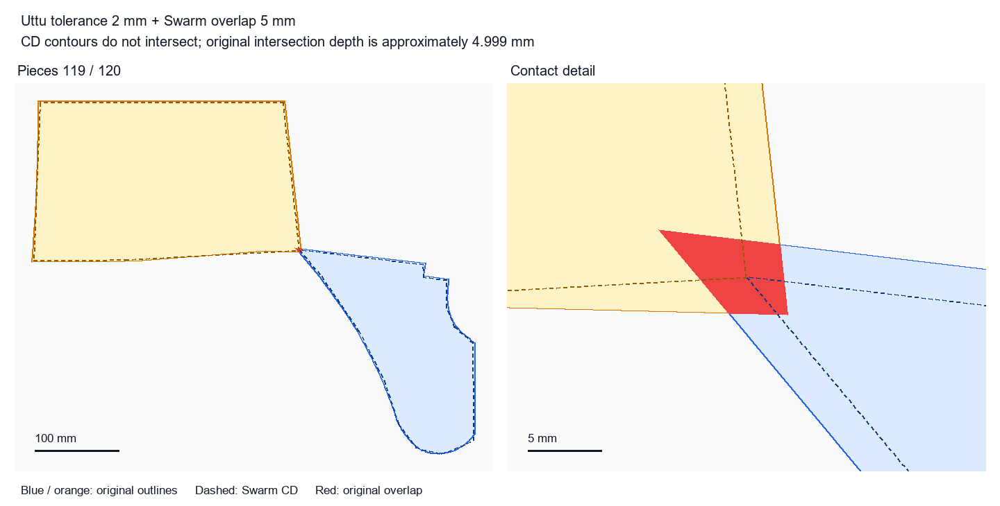

# Uttu 단순화 여유와 Swarm 겹침 허용 검사 — 2026-09-08

## 결론

실제 의류 입력에서도 Uttu 단순화 허용치를 2·3·5mm로 높이는 것만으로 Swarm 겹침 허용 5mm를 원본 깊이 1mm 이하로 제한하지 못했다. Swarm 충돌 도형(CD)이 완전히 떨어져 있어도 원본은 약 5mm 겹치는 반례가 나왔다. 검사한 값 중 1mm는 정상 임포트된 모든 접촉 샘플에서 원본 1mm 기준을 통과했고, 2·3·5mm에서는 반례가 있었다. 이는 검사 범위의 결과이며 모든 회전·배치에서의 수학적 최대값 또는 실제 네스팅 최적값이 아니다.

## 대상과 재현 조건

- 입력: `data/input/wsjk156.json`, 여성WSjk 156개, 원본 정점 33,477개. 입력 JSON의 폴리곤을 원본으로 취급하며 실행 중인 Uttu 프로젝트의 CAD 곡선·Buffer 값까지 검증한 것은 아니다.
- 별도 40×40mm 사각형을 추가해 직선 접촉 계산을 교차 확인했다.
- `C:/Caplanet/Products/uttu/domains/Uttu.Nest.Models/Nesting/NestSource.cs`의 `OuterSimplify` 본문을 그대로 추출하여 Clipper2 2.0.0으로 실행. 원본 union, 0.001mm 양자화, 최종 union도 재현. Buffer=0, 회전=0.
- Uttu 사전 단순화: 우회(현재 Swarm 입력에 해당), 0, 0.5, 1, 2, 3, 5mm. Swarm overlap: 0, 1, 2, 3, 5mm. 실제 Rust importer의 PolySimpl=0.01, narrow-concavity closure 비활성으로 고정.
- Swarm CD를 원래 입력 좌표계로 역변환하고, 순환 인접 ID 쌍마다 ±X·±Y 방향의 극점 정렬 배치를 생성했다. 각 배치에서 두 CD 바운딩 박스는 0.002mm 떨어져 있으므로 도형 간 비충돌을 직접 보장한다.
- 원본 교차 영역의 최대 내접원 지름으로 깊이를 측정했다(GEOS, 반지름 탐색 오차 0.0005mm). 1.002mm 초과를 확실한 위반으로 집계했다. 각 조합의 최악 반례는 Uttu와 동일한 Clipper 교차→깊이/2 침식(Bevel), 좌표 배율 10,000으로 별도 재검사했다.
- 전체 마커 네스팅, strip 경계, 모든 회전·병진 탐색, frozen 정책·콜백 실행, 수율·실행시간 비교는 이번 검사 범위가 아니다. 반례는 충돌 허용 정책의 한계를 확인하기 위한 두 조각 배치다.

## 단순화 여유 실측

경계를 0.5mm 이하 간격으로 표본화했다. 아래 백분율은 경계 표본 비율이며 모든 연속 경계의 엄밀한 길이 비율은 아니다. 허용치는 전체 외곽의 일정한 팽창량이나 원본 대비 엄밀한 최대 거리 상한이 아니다.

| Uttu 허용치 | 정점 수 | 여유 0.1mm 미만 표본 | 여유 2mm 이상 표본 | 여유 95백분위 | 관측 최대 여유 |
|---:|---:|---:|---:|---:|---:|
| 0mm | 33,477 | 100.00% | 0.00% | 0.0004mm | 0.0007mm |
| 0.5mm | 5,719 | 63.50% | 0.00% | 0.3379mm | 0.8951mm |
| 1mm | 3,896 | 47.39% | 0.00% | 0.7398mm | 1.6998mm |
| 2mm | 2,818 | 39.14% | 1.55% | 1.4964mm | 3.8360mm |
| 3mm | 2,358 | 34.75% | 6.86% | 2.1729mm | 5.3699mm |
| 5mm | 1,767 | 27.31% | 21.17% | 3.8322mm | 7.4875mm |

0.5mm 설정에서도 관측 최대 바깥 여유는 약 0.895mm였다. 인접 보정 직선의 교점과 단순화 결과를 사용하므로 설정치와 모든 점의 이동량을 동일시할 수 없다. 또한 양자화/후처리 등으로 원본이 결과 밖에 남는 미세한 편차(최대 관측 약 0.00121mm)도 있어 1mm 한계 검증에는 수치 여유가 필요하다.

## 실제 접촉 반례 — Swarm overlap 5mm

| Uttu 사전 단순화 | 검사한 접촉 | 원본 1mm 초과 | 원본 최대 깊이(GEOS) | Uttu 방식 재검사 |
|---|---:|---:|---:|---:|
| 우회(현재 입력 경로) | 624 | 594 | 4.9986mm | 4.9986mm |
| 0mm | 624 | 595 | 4.9987mm | 4.9987mm |
| 0.5mm | 입력 거부 | — | — | — |
| 1mm | 입력 거부 | — | — | — |
| 2mm | 624 | 555 | 4.9985mm | 4.9987mm |
| 3mm | 624 | 493 | 4.9972mm | 4.9971mm |
| 5mm | 624 | 466 | 4.9962mm | 4.9961mm |

정상 임포트 23개 조합에서 의류 접촉 14,352건 및 사각형 접촉 92건을 검사했다. 최악 사례의 CD 교차 면적은 Uttu 방식 재검사에서도 모두 0이었다. 직선 사각형에서는 Swarm overlap 1·2·3·5mm에 대해 원본 깊이가 각각 약 0.998·1.998·2.998·4.998mm였다(배치에 둔 0.002mm 틈 반영).



## 입력 거부 원인

총 35개 조합 중 12개가 `Simple polygon contains intersecting edges`로 거부됐다. 아래는 실패 조각을 별도로 임포트해 재현한 결과다. 이 조합들을 정상 네스팅 성공으로 집계하지 않았다.

| Uttu 허용치 | Swarm overlap | 실패 조각 ID | PolySimpl 없이도 실패 |
|---:|---:|---|---|
| 0.5mm | 1mm | 28, 31, 38, 43, 48, 50, 108, 110, 139 | True |
| 0.5mm | 2mm | 32, 33, 34, 35, 43, 49 | True |
| 0.5mm | 3mm | 32, 33, 34, 35, 50, 108, 110 | True |
| 0.5mm | 5mm | 40, 108 | True |
| 1mm | 1mm | 32, 33, 34, 35, 47, 49, 50, 96, 97, 98, 99, 108 | True |
| 1mm | 2mm | 49, 68, 69, 70, 71, 96, 97, 98, 99 | True |
| 1mm | 3mm | 49, 50, 96, 97, 98, 99, 108, 111 | True |
| 1mm | 5mm | 108 | True |
| 2mm | 1mm | 96, 97, 98, 99 | True |
| 2mm | 2mm | 96, 97, 98, 99 | True |
| 2mm | 3mm | 96, 97, 98, 99 | True |
| 5mm | 2mm | 37 | True |

모든 재현 실패는 PolySimpl을 끈 진단에서도 발생했다. 따라서 이 사례의 자기교차는 Swarm의 면적 단순화 이전 입력/음수 오프셋 경로에서 발생한다. 원본 Uttu 사전 단순화 결과는 독립 GEOS 검사에서 모두 유효했다. 제품 코드의 오류 복구·오프셋 커널 수정은 이번 판단 검사에 포함하지 않았다.

## 적용 판단

1. 현재 `SwarmInputBuilder.ToAnchoredPolygon`은 원본 `polygon.Buffer(part.Buffer)`를 보낸다. Uttu `CurveTolerance`만 바꿔서는 Swarm 입력이 달라지지 않는다. 이 보고서의 사전 단순화는 별도 검사 도구에서 연결한 가정이다.
2. 직선/여유가 작은 경계가 남아 있으므로 전역 overlap 5mm를 단순화만으로 정당화할 수 없다. 본 샘플에서 통과한 전역값은 검사한 양수 값 중 1mm뿐이다. 1~2mm 사이의 정확한 최초 실패값을 탐색하지 않았고, 1mm의 모든 배치 보장을 선언하지 않는다.
3. 5mm를 탐색에 활용하려면 원본 깊이 1mm를 별도 비용·분리·최종 검증 기준으로 적용해야 한다. 실제 여유가 충분한 접촉에서만 큰 허용값을 활용하고, 부족한 접촉은 이동시켜야 한다. 수율 유지 여부는 동일 입력·seed·시간 예산의 전체 네스팅 비교가 추가로 필요하다.
4. `Products/uttu`의 현재 UI 상수 `MinOverlapDepth=5`는 도형 부풀림량이 아니다. 1mm 목표보다 느슨하여 UI에 겹침이 표시되지 않는 것만으로 원본 1mm 이하라고 판단할 수 없다.

## 산출물과 변경 범위

제품 알고리즘·Config·DLL은 변경하지 않았다. 재현 도구 3개와 Rust 검사 example, 이 보고서/그림을 추가했다. 생성된 JSON 및 C# 검사는 `target/overlap-margin-audit/`에 있다. 소스와 입력 SHA256은 `provenance.json`에 기록했다.

```powershell
python -X utf8 scripts/prepare_overlap_margin_audit.py
dotnet run --project target/overlap-margin-audit/probe.csproj -c Release -- target/overlap-margin-audit/input.json target/overlap-margin-audit
cargo run -p swarm-core --example overlap_margin_audit --release --features "simd capmods adaptive structure-first" --offline -- target/overlap-margin-audit
python -X utf8 scripts/analyze_overlap_margin_audit.py
dotnet run --project target/overlap-margin-audit/probe.csproj -c Release -- --verify target/overlap-margin-audit
cargo run -p swarm-core --example overlap_margin_audit --release --features "simd capmods adaptive structure-first" --offline -- target/overlap-margin-audit --diagnose
python -X utf8 scripts/report_overlap_margin_audit.py
```
